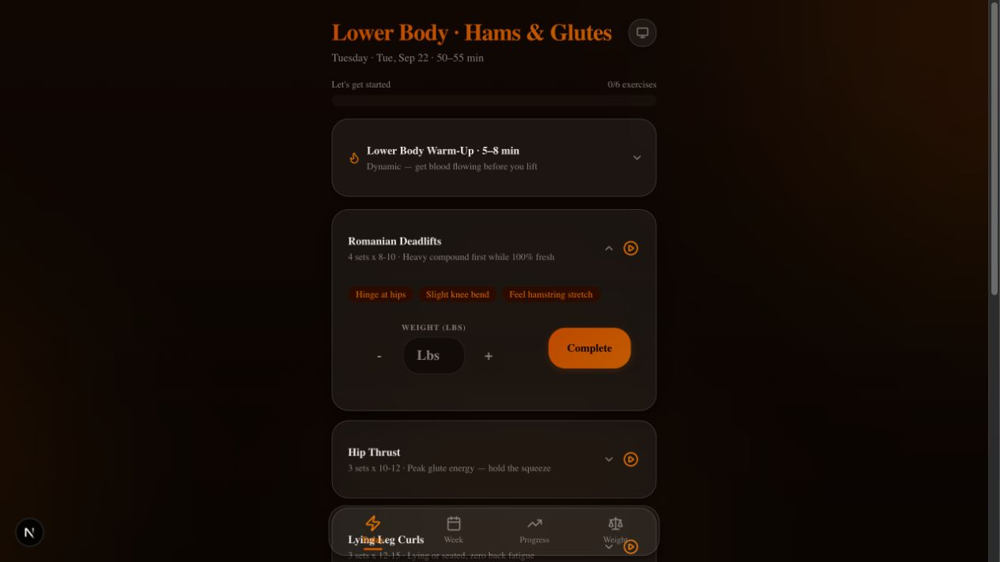
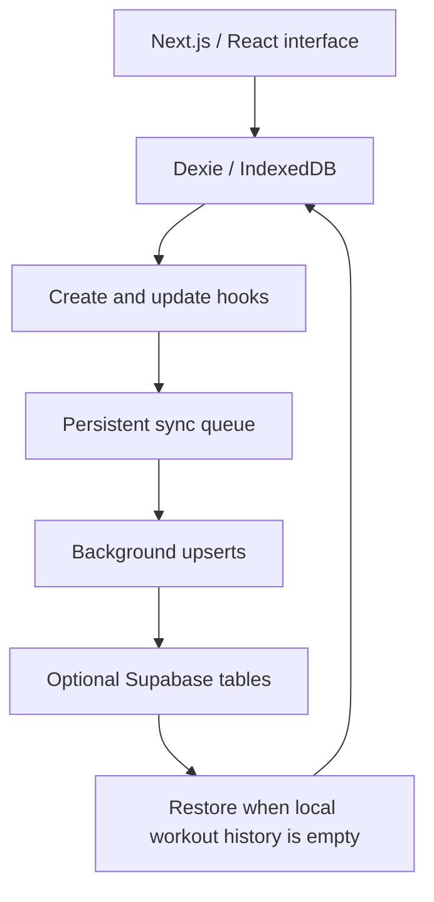

# Workout Tracker

A phone-friendly training log designed for use at the gym: open today's program, check exercise cues, record a weight, and mark an exercise complete. Workout records live in the browser, with optional cloud backup and restore.

**[Open the deployed app](https://workout-tracker-two-beta.vercel.app)**



*Local development capture, September 22, 2026, using the bundled program with no personal workout history or cloud connection.*

## Try it

Open **Today** and expand an exercise to see its cues, weight entry, and completion control. **Week** shows the training schedule; **Progress** and **Weight** provide views of recorded history. For an isolated demo, use the local setup below with no cloud configuration.

## A quick review

1. **See the workflow:** open [the app](https://workout-tracker-two-beta.vercel.app), expand an exercise on **Today**, and inspect its cues and weight controls. Use the local setup below for an isolated trial without a cloud connection.
2. **Follow a record:** inspect [the local database](src/lib/db/) and [the sync queue](src/lib/sync/sync-queue.ts) to see how workout entries are stored and optionally backed up.
3. **Examine the tradeoff:** compare [push behavior](src/lib/sync/sync-push.ts) with [restore behavior](src/lib/sync/sync-pull.ts). The implementation favors browser-local use with optional backup; continuous multi-device conflict resolution is outside its scope.

## What the project demonstrates

- **Local-first storage:** Dexie/IndexedDB holds the program, workout logs, exercise records, and body metrics.
- **A focused mobile workflow:** warm-ups, exercise cues, weight controls, completion tracking, and daily notes.
- **History-based weight reference:** the progression function finds the most recent completed workout for an exercise and uses its recorded weight to prefill the next entry. It does not automatically prescribe an increase or use an AI model.
- **Optional backup and restore:** a persistent queue captures changes to workout logs, set logs, and body metrics; a background process pushes them to a configured Supabase backend.

## Engineering decisions

| Constraint | Implementation | Tradeoff |
| --- | --- | --- |
| Recording a workout should not depend on network availability | Browser-local database and a service worker | Offline reopening needs a previously loaded/cached app; clearing browser storage removes local records. |
| Cloud delivery can fail | [A persistent queue](src/lib/sync/sync-queue.ts), retried pushes, and ID-based upserts | Sync failures are logged; this is not a full conflict-resolution protocol. |
| Child records reference parent workouts | [The pusher](src/lib/sync/sync-push.ts) orders tables and collapses duplicate IDs within a batch | Concurrent edits across devices are not reconciled. |
| An unfinished entry should not replace the last completed weight | [Progression logic](src/lib/progression/engine.ts) filters completed records before selecting the latest workout | The suggestion is a historical reference, not an adaptive training prescription. |

## Architecture



**Stack:** Next.js 16, React 19, TypeScript, Tailwind CSS, Base UI, Dexie, Zustand, Recharts, optional Supabase.

## Run locally

Use Node 20.9+ and pnpm. The repository includes a pnpm lockfile.

```bash
pnpm install --frozen-lockfile --ignore-scripts
npm run dev
```

Open `http://localhost:3000`. No `.env.local` is required for local-only use. The install command deliberately leaves dependency build scripts disabled; the local development view was verified with this setup. `npm run dev` runs the package script using the installed dependencies without replacing the pnpm lockfile.

The program is seeded from [`src/lib/workout-plan/`](src/lib/workout-plan/) and [`src/lib/db/seed.ts`](src/lib/db/seed.ts).

## Cloud behavior and limits

Cloud integration is optional and intended for a configured personal deployment. The implementation reads `NEXT_PUBLIC_SUPABASE_URL` and `NEXT_PUBLIC_SUPABASE_ANON_KEY`. Those variables alone are **not a complete backend setup**: matching tables and appropriate access policies are also required, and schema migrations are not included in this repository.

[Restore](src/lib/sync/sync-pull.ts) runs when the local workout-log table is empty. The app does not continuously pull remote edits into an already populated device, resolve concurrent changes, or synchronize deletions. Programs and exercise templates remain locally seeded. Do not interpret this as a ready-made multi-user service.

The [service worker](public/sw.js) caches app routes/assets for offline use, but deliberately bypasses requests on localhost. A local development screenshot does not verify production offline behavior or cloud restore.

## Source map

- [`src/app/today/`](src/app/today/) — daily workout view.
- [`src/components/workout/`](src/components/workout/) — exercise interaction components.
- [`src/lib/db/`](src/lib/db/) — schema, seeding, and local access.
- [`src/lib/progression/engine.ts`](src/lib/progression/engine.ts) — completed-history weight reference.
- [`src/lib/sync/`](src/lib/sync/) — queue, backup, and restore.

## Project context

A personal project by Cody Ostler, developed with AI coding assistance. The emphasis is a practical training workflow and explicit storage tradeoffs. Production offline recovery and multi-device behavior require separate testing; the screenshot demonstrates the local interface.
